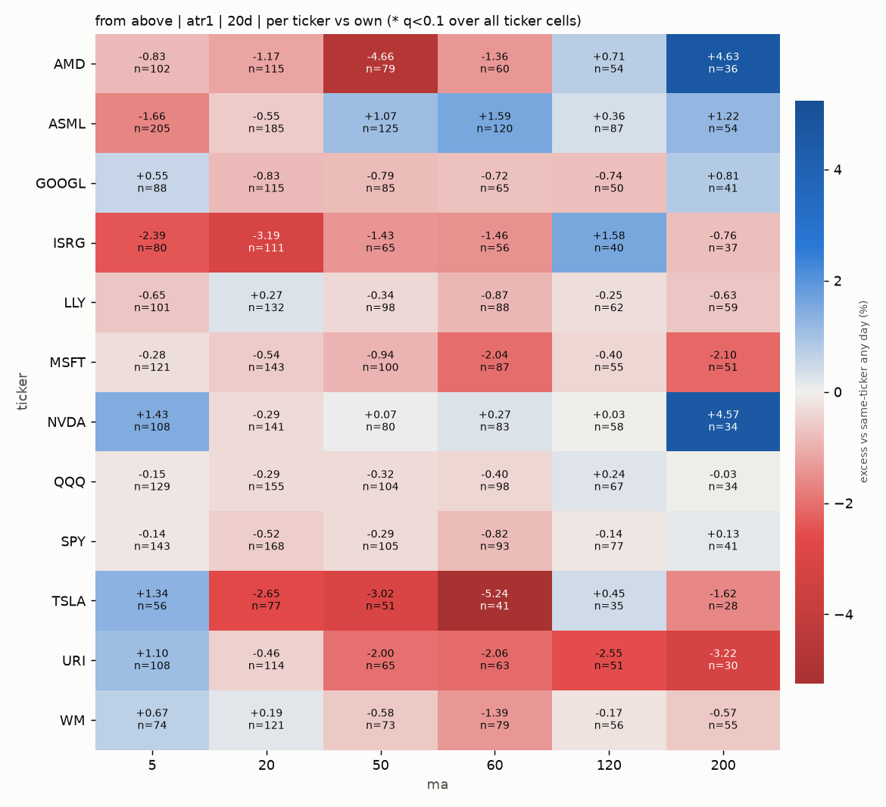
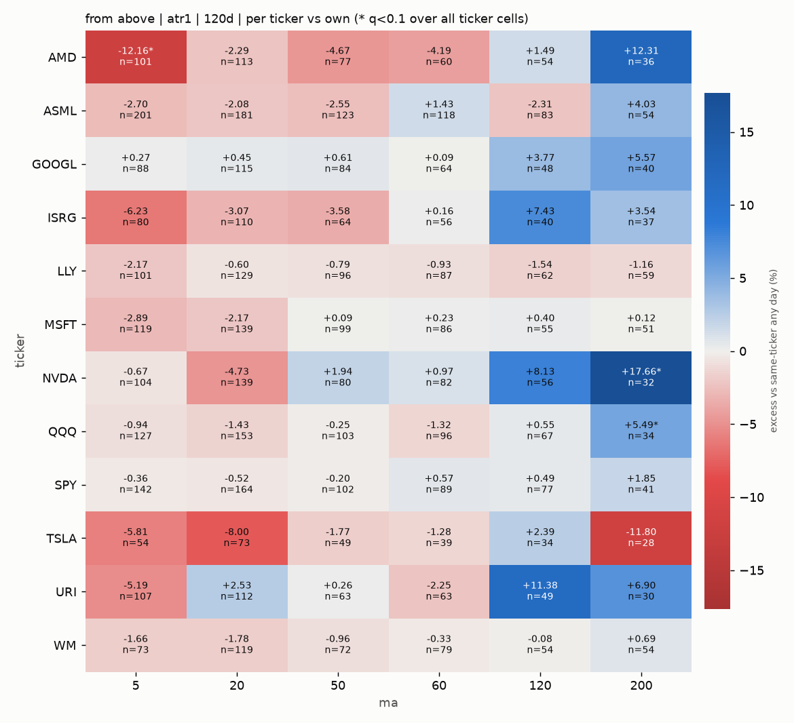

# Buy a Dip? - Results

Generated 2026-11-05T18:19:48+00:00 | sample **2000-01-03 -> 2026-10-30** (6748 bars) | 12 tickers: SPY, QQQ, TSLA, GOOGL, NVDA, AMD, ASML, MSFT, ISRG, URI, WM, LLY

Later listings enter when their MA is warm: TSLA 2010, GOOGL 2004, ISRG 2000.

Tests: 144 pooled cells x 2 benchmarks, 1728 per-ticker cells. Significance = circular time-shift placebo, BH-FDR within each benchmark. **Bold / \*** = q < 0.1.

> Signal: today's **open** within +/-k ATR of yesterday's MA, after yesterday's close was outside the zone. Buy at that open, sell at the open h trading days later, total-return prices.
> Benchmarks (not timing the market): **own** = average h-day return of buying the same ticker on any day within +/-126 bars; **spy** = SPY over the identical dates.

## 1. Scorecard - dip from above

| hold | cells | own: share > 0 | own: median | own: sig + / - | spy: share > 0 | spy: median | spy: sig + / - |
|---|---|---|---|---|---|---|---|
| 5d | 12 | 33% | -0.05% | 0 / 1 | 100% | +0.25% | 0 / 0 |
| 10d | 12 | 50% | -0.02% | 0 / 1 | 92% | +0.59% | 0 / 0 |
| 20d | 12 | 25% | -0.23% | 0 / 3 | 100% | +0.90% | 0 / 0 |
| 60d | 12 | 33% | -0.40% | 1 / 1 | 100% | +2.97% | 0 / 0 |
| 120d | 12 | 42% | -0.49% | 4 / 3 | 100% | +7.14% | 0 / 0 |
| 250d | 12 | 58% | +0.46% | 0 / 1 | 100% | +17.17% | 0 / 0 |

## 2. Excess return grids

**from above | atr0.5 | vs same ticker, any day (+/-126 bars)**

| MA \ hold | 5d | 10d | 20d | 60d | 120d | 250d |
|---|---|---|---|---|---|---|
| 5 | -0.2% | +0.0% | -0.3% | -0.7% | **-1.3%** | -0.6% |
| 20 | -0.0% | +0.1% | -0.2% | -0.0% | -0.9% | -0.1% |
| 50 | -0.0% | -0.1% | -0.2% | -0.6% | -0.6% | +0.7% |
| 60 | -0.1% | -0.2% | -0.6% | -0.2% | +0.0% | +0.8% |
| 120 | +0.2% | +0.3% | +0.0% | +0.2% | **+3.1%** | +2.2% |
| 200 | +0.4% | +0.5% | +0.4% | +1.8% | **+3.3%** | +1.8% |

**from above | atr1 | vs same ticker, any day (+/-126 bars)**

| MA \ hold | 5d | 10d | 20d | 60d | 120d | 250d |
|---|---|---|---|---|---|---|
| 5 | **-0.4%** | -0.2% | -0.2% | **-1.7%** | **-3.1%** | **-2.9%** |
| 20 | -0.1% | -0.3% | **-0.7%** | -0.9% | **-1.8%** | -1.0% |
| 50 | -0.1% | -0.0% | **-0.9%** | -1.1% | -0.9% | -1.3% |
| 60 | -0.2% | **-0.6%** | **-0.9%** | -0.9% | -0.4% | +0.3% |
| 120 | +0.1% | +0.1% | -0.1% | +0.9% | **+2.1%** | +1.7% |
| 200 | +0.2% | +0.2% | +0.2% | **+2.2%** | **+3.4%** | +2.6% |

**from above | atr0.5 | vs SPY, same dates**

| MA \ hold | 5d | 10d | 20d | 60d | 120d | 250d |
|---|---|---|---|---|---|---|
| 5 | +0.2% | +0.8% | +1.2% | +3.4% | +7.1% | +19.2% |
| 20 | +0.4% | +0.9% | +1.3% | +4.0% | +7.5% | +18.3% |
| 50 | +0.2% | +0.5% | +1.0% | +2.4% | +5.6% | +16.0% |
| 60 | +0.2% | +0.4% | +0.8% | +2.8% | +6.7% | +16.1% |
| 120 | +0.4% | +0.8% | +1.0% | +2.6% | +8.8% | +19.7% |
| 200 | +0.3% | +0.5% | +0.8% | +3.6% | +7.8% | +13.7% |

**from above | atr1 | vs SPY, same dates**

| MA \ hold | 5d | 10d | 20d | 60d | 120d | 250d |
|---|---|---|---|---|---|---|
| 5 | +0.2% | +0.6% | +1.4% | +2.7% | +5.6% | +15.0% |
| 20 | +0.3% | +0.5% | +0.8% | +3.6% | +7.2% | +18.3% |
| 50 | +0.3% | +0.7% | +0.7% | +2.8% | +6.5% | +15.6% |
| 60 | +0.0% | -0.0% | +0.7% | +3.1% | +7.8% | +19.3% |
| 120 | +0.4% | +0.6% | +1.0% | +3.5% | +8.8% | +19.8% |
| 200 | +0.1% | +0.3% | +0.4% | +2.8% | +6.3% | +14.2% |

**from below | atr0.5 | vs same ticker, any day (+/-126 bars)**

| MA \ hold | 5d | 10d | 20d | 60d | 120d | 250d |
|---|---|---|---|---|---|---|
| 5 | **+0.3%** | +0.3% | +0.4% | **+0.9%** | **+1.5%** | **+1.4%** |
| 20 | -0.2% | -0.4% | +0.1% | +0.1% | **+1.3%** | **+1.8%** |
| 50 | -0.3% | +0.1% | +0.4% | +1.2% | **+2.7%** | **+3.5%** |
| 60 | **-0.5%** | -0.2% | +0.0% | +0.9% | **+2.6%** | **+3.4%** |
| 120 | +0.3% | +0.7% | +0.9% | +1.6% | **+3.0%** | **+3.2%** |
| 200 | +0.3% | +0.5% | +1.0% | **+2.6%** | **+3.3%** | **+3.8%** |

**from below | atr1 | vs same ticker, any day (+/-126 bars)**

| MA \ hold | 5d | 10d | 20d | 60d | 120d | 250d |
|---|---|---|---|---|---|---|
| 5 | **+0.5%** | +0.3% | +0.4% | +1.0% | **+1.9%** | **+2.3%** |
| 20 | -0.2% | -0.1% | +0.2% | **+1.4%** | **+3.0%** | **+2.9%** |
| 50 | **-0.8%** | **-0.8%** | -0.6% | +0.6% | **+2.7%** | **+3.8%** |
| 60 | -0.0% | +0.2% | +0.4% | +1.3% | **+2.4%** | **+4.3%** |
| 120 | +0.1% | -0.0% | +0.1% | +1.7% | **+3.5%** | **+4.5%** |
| 200 | +0.3% | +0.2% | +0.6% | +1.6% | +2.4% | +3.4% |

**from below | atr0.5 | vs SPY, same dates**

| MA \ hold | 5d | 10d | 20d | 60d | 120d | 250d |
|---|---|---|---|---|---|---|
| 5 | +0.3% | +0.7% | +1.3% | +3.8% | +8.0% | +18.3% |
| 20 | +0.1% | +0.1% | +1.1% | +3.3% | +8.3% | +20.3% |
| 50 | +0.0% | +0.6% | +1.2% | +3.9% | +8.5% | +20.1% |
| 60 | -0.1% | +0.4% | +1.1% | +3.4% | +8.1% | +20.3% |
| 120 | +0.4% | +0.6% | +0.9% | +2.2% | +6.4% | +16.5% |
| 200 | +0.5% | +0.8% | +1.1% | +3.3% | +6.7% | +16.9% |

**from below | atr1 | vs SPY, same dates**

| MA \ hold | 5d | 10d | 20d | 60d | 120d | 250d |
|---|---|---|---|---|---|---|
| 5 | +0.4% | +0.5% | +1.1% | +3.2% | +7.0% | +17.1% |
| 20 | -0.0% | +0.2% | +0.9% | +3.6% | +8.6% | +19.8% |
| 50 | **-0.5%** | -0.2% | +0.3% | +2.8% | +7.7% | +19.6% |
| 60 | +0.2% | +0.6% | +1.2% | +3.5% | +7.2% | +19.9% |
| 120 | +0.3% | +0.4% | +0.9% | +3.3% | +8.0% | +20.1% |
| 200 | +0.1% | +0.0% | +0.5% | +1.6% | +4.7% | +14.5% |

## 3. Strongest dip cells (by placebo z, own benchmark)

| MA | band | hold | n | raw | own base | excess own | excess spy | hit | base hit | MAE p10 | z | q |
|---|---|---|---|---|---|---|---|---|---|---|---|---|
| 120 | atr0.5 | 120 | 633 | +12.8% | +9.7% | +3.11% | +8.83% | 68% | 66% | -38.0% | 3.26 | 0.01 |
| 200 | atr1 | 120 | 496 | +12.5% | +9.1% | +3.42% | +6.33% | 68% | 66% | -31.5% | 2.71 | 0.03 |
| 200 | atr0.5 | 120 | 445 | +12.0% | +8.7% | +3.27% | +7.75% | 68% | 64% | -35.5% | 2.48 | 0.05 |
| 120 | atr1 | 120 | 679 | +13.0% | +10.8% | +2.15% | +8.81% | 67% | 68% | -34.4% | 2.31 | 0.07 |
| 200 | atr1 | 60 | 500 | +6.6% | +4.4% | +2.24% | +2.82% | 63% | 60% | -23.5% | 2.26 | 0.07 |
| 200 | atr1 | 250 | 479 | +25.3% | +22.7% | +2.59% | +14.18% | 76% | 73% | -45.9% | 2.06 | 0.10 |
| 120 | atr0.5 | 250 | 618 | +27.8% | +25.5% | +2.23% | +19.67% | 72% | 72% | -46.8% | 1.82 | 0.17 |
| 200 | atr0.5 | 60 | 452 | +6.0% | +4.2% | +1.81% | +3.57% | 61% | 59% | -26.0% | 1.74 | 0.19 |
| 120 | atr1 | 250 | 667 | +28.0% | +26.3% | +1.69% | +19.82% | 73% | 73% | -50.0% | 1.67 | 0.19 |
| 200 | atr0.5 | 250 | 437 | +22.4% | +20.6% | +1.79% | +13.74% | 73% | 72% | -48.7% | 1.43 | 0.29 |

## 4. How often does each definition fire? (median across tickers)

| MA | atr0.5: % days in zone / dips per yr | atr1: % days in zone / dips per yr |
|---|---|---|
| 5 | 47% / 8.0 | 77% / 4.0 |
| 20 | 21% / 5.2 | 40% / 5.1 |
| 50 | 12% / 3.2 | 24% / 3.4 |
| 60 | 11% / 2.9 | 22% / 3.0 |
| 120 | 8% / 2.1 | 16% / 2.2 |
| 200 | 5% / 1.5 | 11% / 1.7 |

## 5. Regime: SPY above vs below its 200-day SMA (excess vs own, dip from above, atr1)

| MA | hold | n up | excess up | n down | excess down |
|---|---|---|---|---|---|
| 5 | 20 | 996 | -0.62% | 319 | +0.98% |
| 20 | 20 | 1236 | -1.00% | 341 | +0.32% |
| 50 | 20 | 791 | -0.90% | 239 | -0.83% |
| 60 | 20 | 728 | -0.76% | 205 | -1.30% |
| 120 | 20 | 521 | +0.06% | 171 | -0.53% |
| 200 | 20 | 360 | -0.03% | 140 | +0.63% |
| 5 | 60 | 987 | -2.68% | 319 | +1.32% |
| 20 | 60 | 1223 | -2.18% | 341 | +3.65% |
| 50 | 60 | 785 | -1.63% | 239 | +0.48% |
| 60 | 60 | 722 | -1.15% | 205 | -0.09% |
| 120 | 60 | 515 | +0.89% | 171 | +1.05% |
| 200 | 60 | 360 | +1.21% | 140 | +4.88% |
| 5 | 120 | 978 | -4.65% | 319 | +1.59% |
| 20 | 120 | 1206 | -3.49% | 341 | +4.21% |
| 50 | 120 | 773 | -1.38% | 239 | +0.51% |
| 60 | 120 | 714 | -0.01% | 205 | -1.65% |
| 120 | 120 | 508 | +1.94% | 171 | +2.76% |
| 200 | 120 | 356 | +2.77% | 140 | +5.06% |
| 5 | 250 | 956 | -4.78% | 314 | +2.76% |
| 20 | 250 | 1183 | -2.89% | 341 | +5.38% |
| 50 | 250 | 743 | -1.82% | 239 | +0.19% |
| 60 | 250 | 691 | -0.07% | 204 | +1.38% |
| 120 | 250 | 496 | +2.79% | 171 | -1.48% |
| 200 | 250 | 342 | +3.03% | 137 | +1.47% |

## 6. Stability by period (excess vs own, dip from above, atr1)

| hold | MA | 2000-02 dot-com bust | 2003-07 | 2008-09 GFC | 2010-19 | 2020-26 |
|---|---|---|---|---|---|---|
| 20 | 5 | +0.3% | -0.2% | +0.1% | -0.1% | -0.7% |
| 20 | 20 | +1.1% | -0.9% | -0.1% | -1.0% | -0.8% |
| 20 | 50 | -0.9% | -0.3% | +0.0% | -0.4% | -2.1% |
| 20 | 60 | -1.0% | -0.8% | +2.0% | -0.9% | -1.5% |
| 20 | 120 | -1.1% | +0.6% | -2.7% | +0.1% | +0.0% |
| 20 | 200 | -2.8% | +0.7% | -1.0% | +0.3% | +0.6% |
| 60 | 5 | -3.4% | -1.2% | -1.4% | -1.3% | -2.1% |
| 60 | 20 | -0.4% | +0.6% | +0.2% | -1.4% | -1.5% |
| 60 | 50 | -5.1% | +1.1% | -0.2% | -0.9% | -1.6% |
| 60 | 60 | -5.8% | +0.3% | +1.6% | -0.6% | -1.0% |
| 60 | 120 | -0.6% | +0.2% | -2.0% | +0.3% | +4.0% |
| 60 | 200 | -3.4% | +2.6% | +1.7% | +0.6% | +6.7% |
| 120 | 5 | -10.1% | -3.1% | -2.0% | -2.5% | -1.5% |
| 120 | 20 | -4.1% | -0.9% | +2.4% | -2.5% | -1.6% |
| 120 | 50 | -6.4% | +2.1% | -2.9% | -1.3% | +0.1% |
| 120 | 60 | -10.4% | +1.7% | +2.3% | -0.1% | +0.9% |
| 120 | 120 | -6.3% | +4.3% | -0.2% | +0.4% | +8.8% |
| 120 | 200 | -4.7% | +4.4% | +1.7% | +0.6% | +10.6% |
| 250 | 5 | -6.0% | -2.9% | -4.6% | -1.7% | -3.2% |
| 250 | 20 | -1.2% | -2.3% | -0.1% | -1.0% | -0.5% |
| 250 | 50 | -3.4% | +0.3% | -6.9% | -0.1% | -1.9% |
| 250 | 60 | -3.0% | +0.3% | -0.1% | +0.9% | +0.5% |
| 250 | 120 | -6.9% | -0.0% | -2.3% | +2.4% | +7.2% |
| 250 | 200 | -5.7% | +1.7% | -2.6% | +2.8% | +7.6% |

## 7. Tradable strategy (buy at the dip open, sell at open h days later, 5 bps/side)

Equal-weight across tickers listed that day (idle sleeve = cash at 0%) vs equal-weight buy & hold.

| MA | band | hold | CAGR | B&H CAGR | Sharpe | B&H Sharpe | MaxDD | B&H MaxDD |
|---|---|---|---|---|---|---|---|---|
| 5 | atr0.5 | 5 | +1.1% | +23.2% | 0.18 | 0.92 | -32% | -63% |
| 5 | atr0.5 | 10 | +6.7% | +23.2% | 0.65 | 0.92 | -34% | -63% |
| 5 | atr0.5 | 20 | +10.9% | +23.2% | 0.72 | 0.92 | -51% | -63% |
| 5 | atr0.5 | 60 | +19.1% | +23.2% | 0.85 | 0.92 | -60% | -63% |
| 5 | atr0.5 | 120 | +22.3% | +23.2% | 0.91 | 0.92 | -62% | -63% |
| 5 | atr0.5 | 250 | +22.2% | +23.2% | 0.90 | 0.92 | -63% | -63% |
| 20 | atr0.5 | 5 | +1.8% | +23.2% | 0.39 | 0.92 | -19% | -63% |
| 20 | atr0.5 | 10 | +5.0% | +23.2% | 0.71 | 0.92 | -25% | -63% |
| 20 | atr0.5 | 20 | +7.5% | +23.2% | 0.70 | 0.92 | -42% | -63% |
| 20 | atr0.5 | 60 | +16.7% | +23.2% | 0.86 | 0.92 | -54% | -63% |
| 20 | atr0.5 | 120 | +21.3% | +23.2% | 0.91 | 0.92 | -60% | -63% |
| 20 | atr0.5 | 250 | +22.1% | +23.2% | 0.90 | 0.92 | -63% | -63% |
| 50 | atr0.5 | 5 | +1.0% | +23.2% | 0.29 | 0.92 | -12% | -63% |
| 50 | atr0.5 | 10 | +2.2% | +23.2% | 0.43 | 0.92 | -16% | -63% |
| 50 | atr0.5 | 20 | +4.0% | +23.2% | 0.50 | 0.92 | -30% | -63% |
| 50 | atr0.5 | 60 | +8.9% | +23.2% | 0.62 | 0.92 | -52% | -63% |
| 50 | atr0.5 | 120 | +15.4% | +23.2% | 0.78 | 0.92 | -58% | -63% |
| 50 | atr0.5 | 250 | +20.2% | +23.2% | 0.86 | 0.92 | -63% | -63% |
| 60 | atr0.5 | 5 | +0.6% | +23.2% | 0.20 | 0.92 | -14% | -63% |
| 60 | atr0.5 | 10 | +1.7% | +23.2% | 0.34 | 0.92 | -18% | -63% |
| 60 | atr0.5 | 20 | +3.1% | +23.2% | 0.42 | 0.92 | -21% | -63% |
| 60 | atr0.5 | 60 | +9.4% | +23.2% | 0.69 | 0.92 | -47% | -63% |
| 60 | atr0.5 | 120 | +15.5% | +23.2% | 0.83 | 0.92 | -49% | -63% |
| 60 | atr0.5 | 250 | +19.9% | +23.2% | 0.86 | 0.92 | -61% | -63% |
| 120 | atr0.5 | 5 | +1.1% | +23.2% | 0.33 | 0.92 | -9% | -63% |
| 120 | atr0.5 | 10 | +2.1% | +23.2% | 0.44 | 0.92 | -15% | -63% |
| 120 | atr0.5 | 20 | +2.8% | +23.2% | 0.43 | 0.92 | -19% | -63% |
| 120 | atr0.5 | 60 | +6.8% | +23.2% | 0.63 | 0.92 | -32% | -63% |
| 120 | atr0.5 | 120 | +13.0% | +23.2% | 0.80 | 0.92 | -48% | -63% |
| 120 | atr0.5 | 250 | +17.7% | +23.2% | 0.83 | 0.92 | -59% | -63% |
| 200 | atr0.5 | 5 | +0.9% | +23.2% | 0.36 | 0.92 | -7% | -63% |
| 200 | atr0.5 | 10 | +1.7% | +23.2% | 0.44 | 0.92 | -9% | -63% |
| 200 | atr0.5 | 20 | +2.4% | +23.2% | 0.46 | 0.92 | -12% | -63% |
| 200 | atr0.5 | 60 | +5.9% | +23.2% | 0.63 | 0.92 | -22% | -63% |
| 200 | atr0.5 | 120 | +9.4% | +23.2% | 0.75 | 0.92 | -34% | -63% |
| 200 | atr0.5 | 250 | +15.2% | +23.2% | 0.86 | 0.92 | -45% | -63% |
| 5 | atr1 | 5 | -0.1% | +23.2% | 0.01 | 0.92 | -17% | -63% |
| 5 | atr1 | 10 | +2.7% | +23.2% | 0.41 | 0.92 | -19% | -63% |
| 5 | atr1 | 20 | +6.3% | +23.2% | 0.62 | 0.92 | -27% | -63% |
| 5 | atr1 | 60 | +11.9% | +23.2% | 0.69 | 0.92 | -53% | -63% |
| 5 | atr1 | 120 | +17.1% | +23.2% | 0.78 | 0.92 | -62% | -63% |
| 5 | atr1 | 250 | +21.4% | +23.2% | 0.88 | 0.92 | -64% | -63% |
| 20 | atr1 | 5 | +1.9% | +23.2% | 0.42 | 0.92 | -14% | -63% |
| 20 | atr1 | 10 | +2.9% | +23.2% | 0.45 | 0.92 | -25% | -63% |
| 20 | atr1 | 20 | +5.3% | +23.2% | 0.53 | 0.92 | -37% | -63% |
| 20 | atr1 | 60 | +15.9% | +23.2% | 0.85 | 0.92 | -55% | -63% |
| 20 | atr1 | 120 | +19.8% | +23.2% | 0.87 | 0.92 | -61% | -63% |
| 20 | atr1 | 250 | +21.5% | +23.2% | 0.88 | 0.92 | -62% | -63% |
| 50 | atr1 | 5 | +1.0% | +23.2% | 0.27 | 0.92 | -14% | -63% |
| 50 | atr1 | 10 | +3.0% | +23.2% | 0.55 | 0.92 | -16% | -63% |
| 50 | atr1 | 20 | +3.1% | +23.2% | 0.40 | 0.92 | -25% | -63% |
| 50 | atr1 | 60 | +10.8% | +23.2% | 0.74 | 0.92 | -48% | -63% |
| 50 | atr1 | 120 | +16.6% | +23.2% | 0.84 | 0.92 | -57% | -63% |
| 50 | atr1 | 250 | +21.1% | +23.2% | 0.90 | 0.92 | -62% | -63% |
| 60 | atr1 | 5 | +0.3% | +23.2% | 0.10 | 0.92 | -21% | -63% |
| 60 | atr1 | 10 | +0.6% | +23.2% | 0.14 | 0.92 | -21% | -63% |
| 60 | atr1 | 20 | +2.2% | +23.2% | 0.30 | 0.92 | -21% | -63% |
| 60 | atr1 | 60 | +8.9% | +23.2% | 0.64 | 0.92 | -41% | -63% |
| 60 | atr1 | 120 | +16.1% | +23.2% | 0.82 | 0.92 | -55% | -63% |
| 60 | atr1 | 250 | +20.3% | +23.2% | 0.88 | 0.92 | -60% | -63% |
| 120 | atr1 | 5 | +1.1% | +23.2% | 0.36 | 0.92 | -12% | -63% |
| 120 | atr1 | 10 | +1.9% | +23.2% | 0.43 | 0.92 | -16% | -63% |
| 120 | atr1 | 20 | +3.0% | +23.2% | 0.48 | 0.92 | -21% | -63% |
| 120 | atr1 | 60 | +8.5% | +23.2% | 0.78 | 0.92 | -34% | -63% |
| 120 | atr1 | 120 | +13.0% | +23.2% | 0.80 | 0.92 | -51% | -63% |
| 120 | atr1 | 250 | +17.9% | +23.2% | 0.84 | 0.92 | -56% | -63% |
| 200 | atr1 | 5 | +0.7% | +23.2% | 0.30 | 0.92 | -14% | -63% |
| 200 | atr1 | 10 | +1.3% | +23.2% | 0.36 | 0.92 | -19% | -63% |
| 200 | atr1 | 20 | +2.3% | +23.2% | 0.44 | 0.92 | -17% | -63% |
| 200 | atr1 | 60 | +7.2% | +23.2% | 0.80 | 0.92 | -26% | -63% |
| 200 | atr1 | 120 | +11.2% | +23.2% | 0.89 | 0.92 | -39% | -63% |
| 200 | atr1 | 250 | +15.3% | +23.2% | 0.85 | 0.92 | -48% | -63% |

Per ticker x spec: share where the dip strategy's Sharpe beats ...

| hold | ticker-specs | buy & hold | median random entry (same #trades, same hold) | top 10% of random | median exposure |
|---|---|---|---|---|---|
| 5 | 144 | 0% | 40% | 10% | 6% |
| 10 | 144 | 1% | 47% | 9% | 12% |
| 20 | 144 | 4% | 42% | 10% | 22% |
| 60 | 144 | 10% | 51% | 7% | 52% |
| 120 | 144 | 23% | 49% | 8% | 76% |
| 250 | 144 | 35% | 46% | 5% | 94% |

No timing skill => 'beats median random' ~50% and 'top 10%' ~10%.
