# Buy a Dip? - Results

Generated 2026-11-05T17:55:22+00:00 | sample **2020-01-02 -> 2026-11-04** (1720 bars) | tickers: SPY, QQQ, TSLA, GOOGL, NVDA, AMD, ASML, MSFT, ISRG, URI, WM, LLY

Tests: 432 pooled cells, 5160 per-ticker cells. Significance = circular time-shift placebo, BH-FDR across all cells.

> Excess return = forward return after the signal minus the average forward return of a random entry day in the same ticker and calendar year. Entry at next open, exit at close of day h, total-return prices, no costs (costs enter only in the strategy section).

## 1. Scorecard - dip from above (the hypothesis)

| horizon (days) | cells | share of cells with excess > 0 | median cell excess | significant + (q<0.10) | significant - |
|---|---|---|---|---|---|
| 5 | 36 | 47% | -0.04% | 0 | 0 |
| 10 | 36 | 19% | -0.22% | 0 | 0 |
| 20 | 36 | 19% | -0.56% | 0 | 0 |
| 60 | 36 | 33% | -0.78% | 0 | 1 |
| 120 | 36 | 42% | -0.26% | 0 | 2 |
| 250 | 36 | 50% | 0.01% | 1 | 0 |

**Strongest 12 cells by placebo z (from above)**

| MA | band | h | n | raw mean | baseline | excess | hit | base hit | MAE p10 | z | q |
|---|---|---|---|---|---|---|---|---|---|---|---|
| 120 | atr0.5 | 250 | 239 | 40.96% | 32.73% | 8.22% | 78% | 77% | -44.2% | 3.24 | 0.09 |
| 200 | atr1 | 120 | 218 | 23.11% | 15.89% | 7.22% | 72% | 71% | -30.0% | 2.73 | 0.18 |
| 200 | atr0.5 | 120 | 198 | 22.31% | 14.71% | 7.61% | 74% | 69% | -31.8% | 2.69 | 0.11 |
| 120 | pct2 | 250 | 257 | 38.56% | 32.13% | 6.44% | 80% | 78% | -41.0% | 2.54 | 0.12 |
| 120 | atr0.5 | 120 | 263 | 20.13% | 15.02% | 5.12% | 74% | 71% | -34.5% | 2.44 | 0.32 |
| 120 | atr1 | 250 | 272 | 40.61% | 33.56% | 7.05% | 81% | 79% | -36.2% | 2.44 | 0.10 |
| 120 | atr1 | 120 | 301 | 20.69% | 16.19% | 4.50% | 76% | 74% | -29.2% | 2.37 | 0.32 |
| 200 | pct5 | 120 | 235 | 21.48% | 15.84% | 5.64% | 74% | 73% | -31.6% | 2.22 | 0.32 |
| 120 | pct1 | 250 | 201 | 36.74% | 31.10% | 5.64% | 77% | 77% | -42.2% | 2.19 | 0.32 |
| 200 | pct3 | 120 | 219 | 21.41% | 15.10% | 6.31% | 68% | 71% | -31.1% | 2.17 | 0.32 |
| 200 | pct1 | 120 | 162 | 18.59% | 13.40% | 5.20% | 74% | 71% | -30.0% | 2.08 | 0.32 |
| 120 | pct5 | 120 | 354 | 19.05% | 15.61% | 3.44% | 73% | 74% | -32.0% | 1.93 | 0.39 |

## 2. How often does each definition fire?

Median across tickers. `in zone` = share of all days with the close inside the band (a band that is almost always 'near' carries no information).

| MA | pct1 in-zone / events/yr | pct2 in-zone / events/yr | pct3 in-zone / events/yr | pct5 in-zone / events/yr | atr0.5 in-zone / events/yr | atr1 in-zone / events/yr |
|---|---|---|---|---|---|---|
| 5 | 39% / 17.6 | 69% / 14.9 | 84% / 9.3 | 96% / 3.7 | 49% / 19.9 | 81% / 12.2 |
| 20 | 17% / 9.3 | 32% / 10.5 | 47% / 10.0 | 70% / 8.1 | 22% / 10.1 | 41% / 11.0 |
| 50 | 8% / 5.8 | 17% / 6.7 | 25% / 6.7 | 41% / 6.5 | 12% / 6.3 | 24% / 6.7 |
| 60 | 7% / 4.9 | 14% / 6.2 | 22% / 6.1 | 37% / 6.2 | 11% / 5.7 | 23% / 6.5 |
| 120 | 5% / 2.9 | 9% / 3.9 | 14% / 4.1 | 24% / 5.0 | 6% / 3.2 | 13% / 3.9 |
| 200 | 3% / 1.9 | 6% / 2.5 | 10% / 2.6 | 16% / 2.9 | 4% / 2.5 | 9% / 2.5 |

## 3. Heatmaps (excess %, pooled)

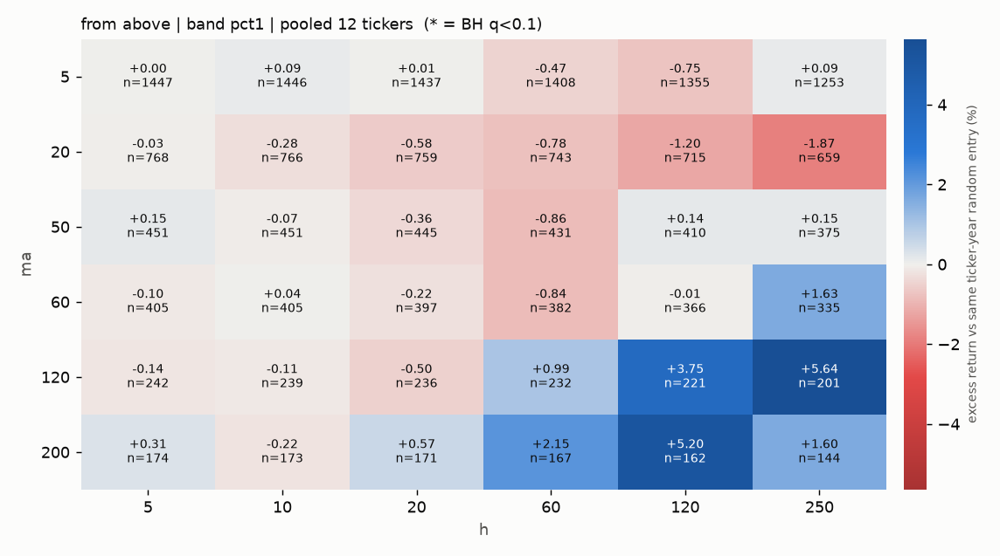

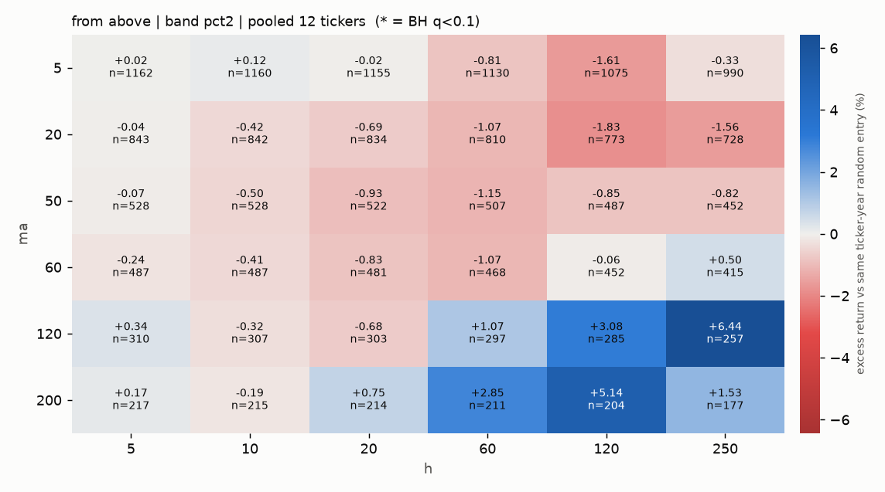

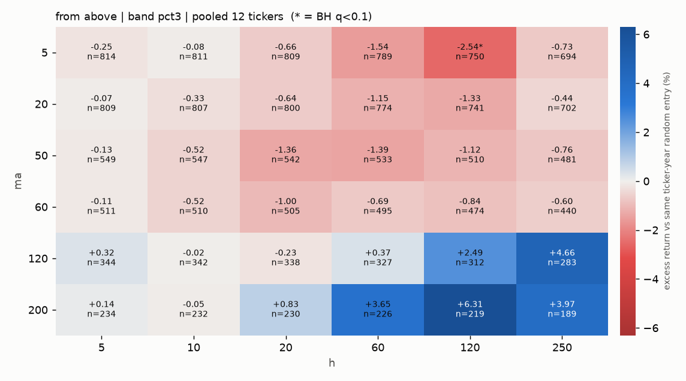

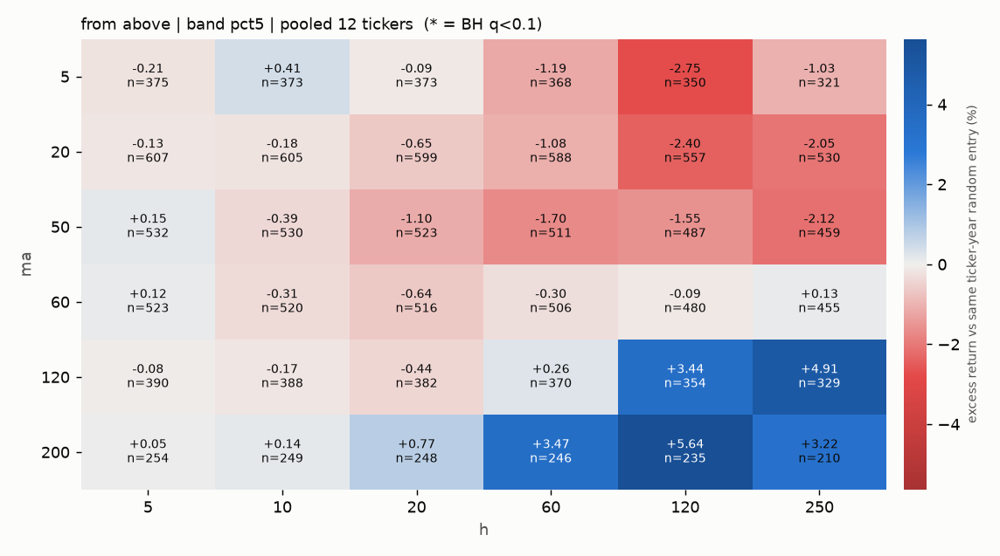

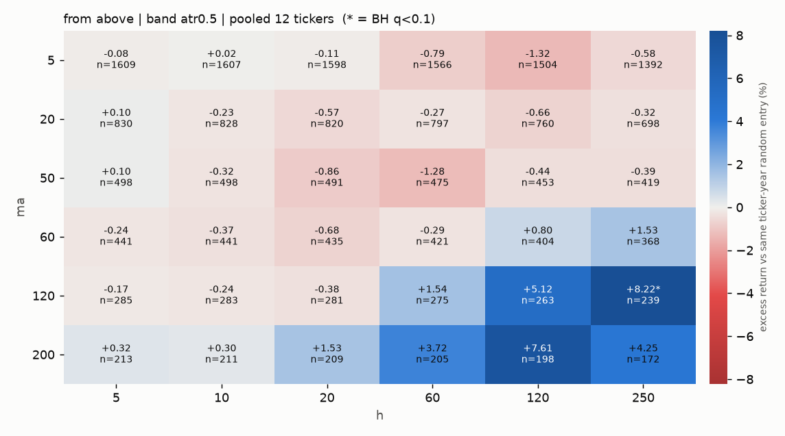

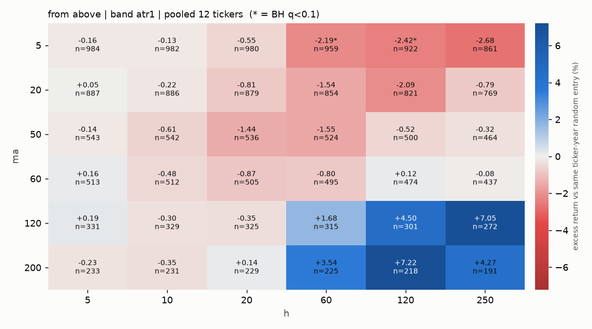

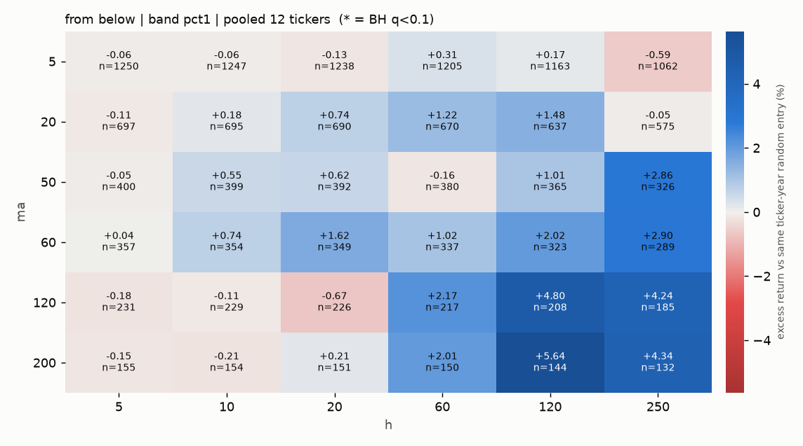

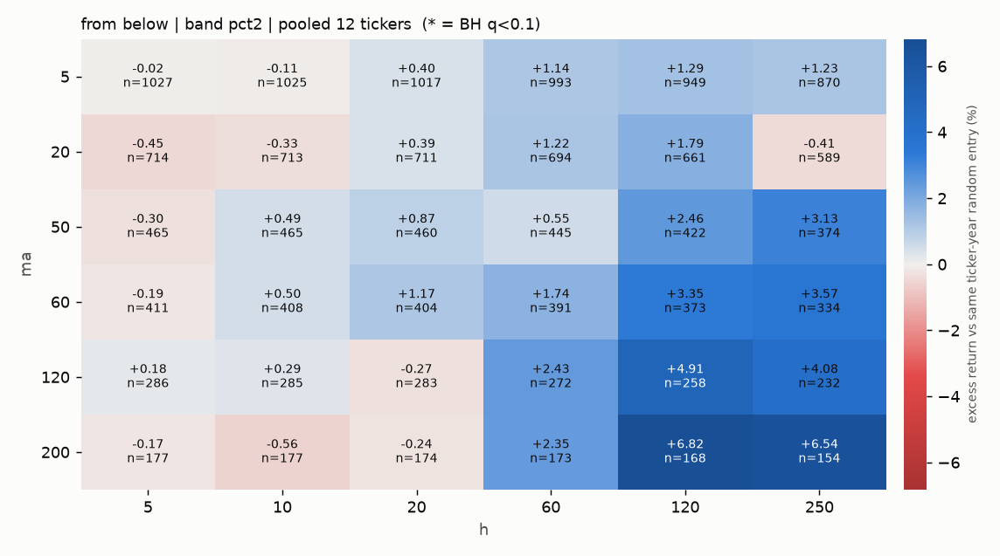

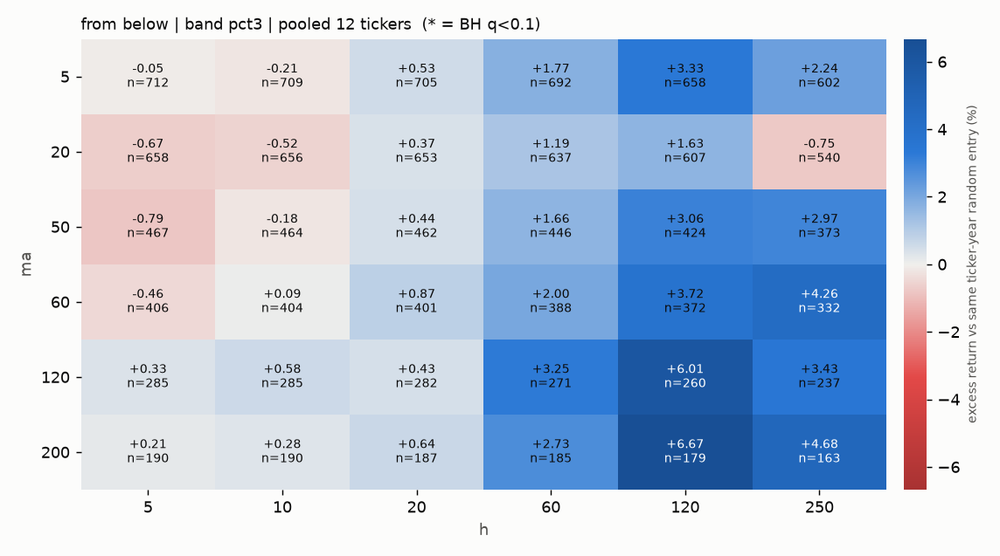

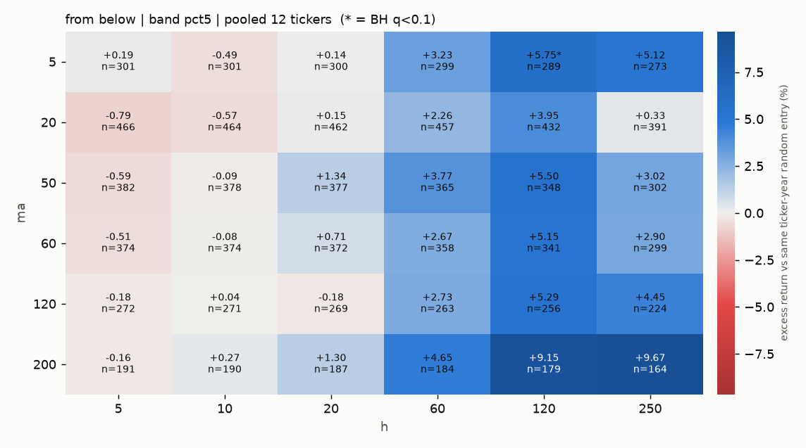

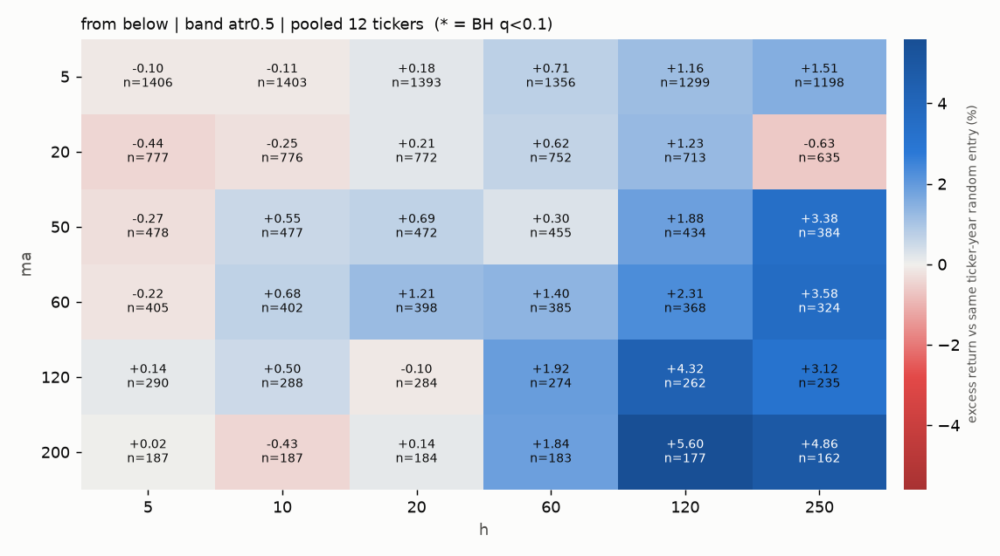

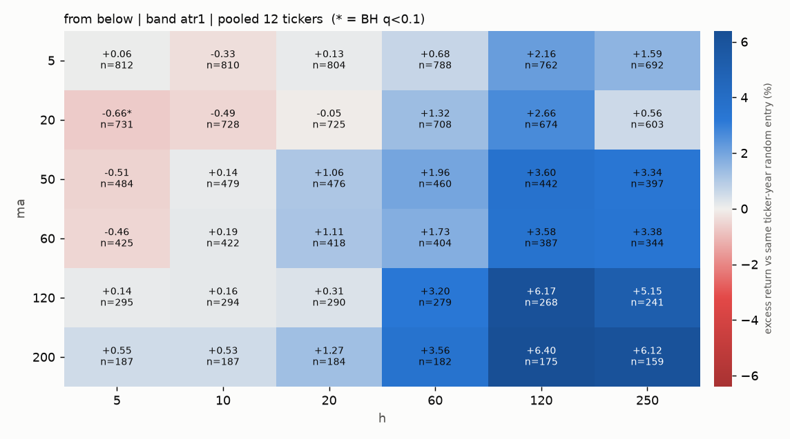

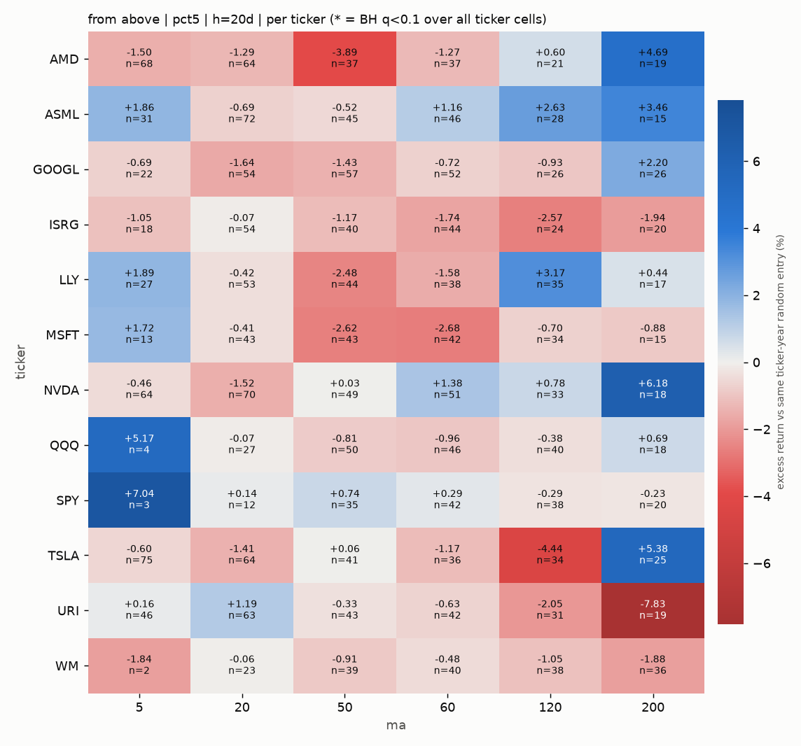

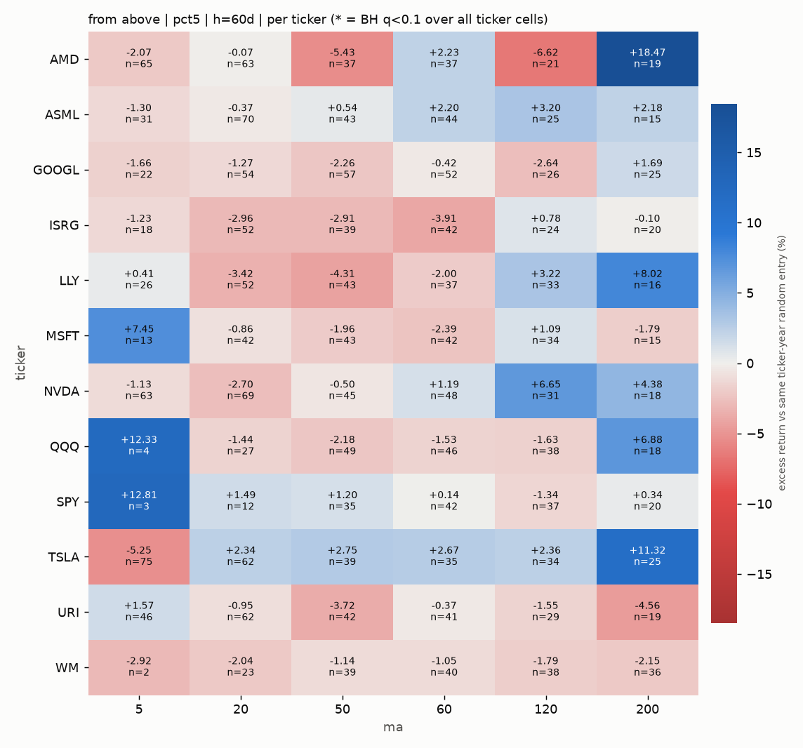

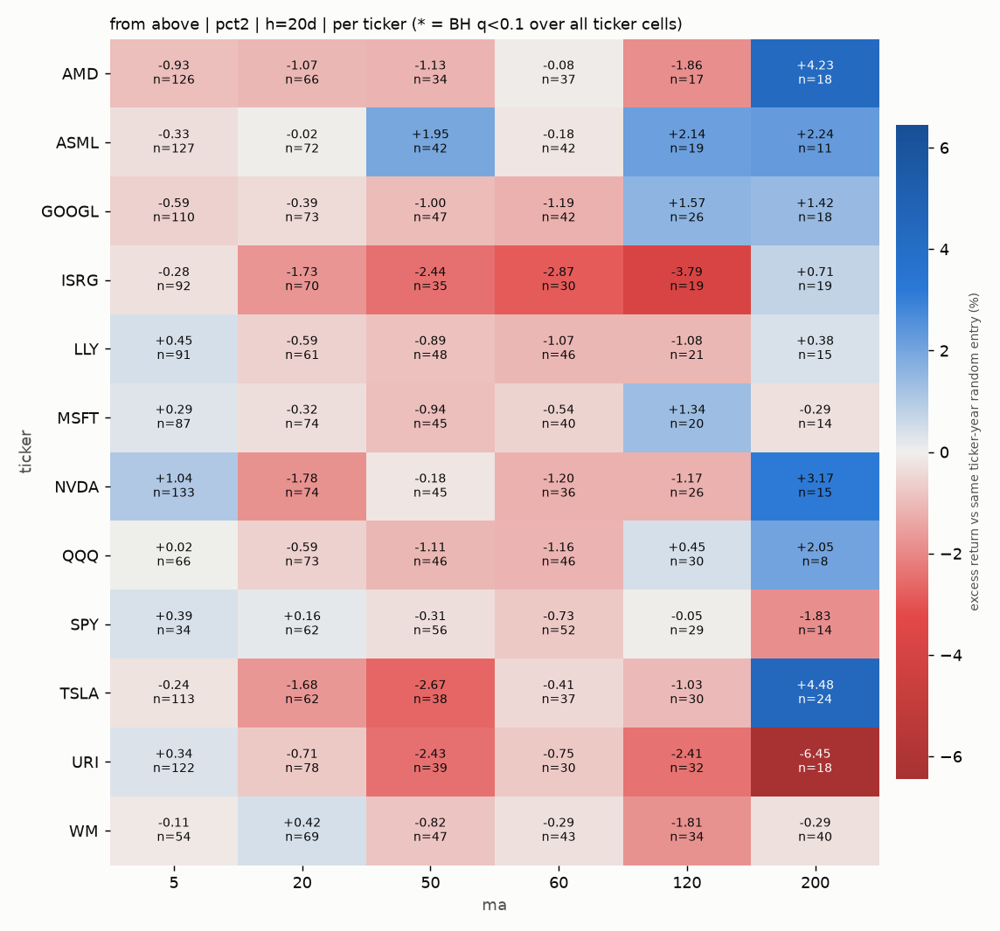

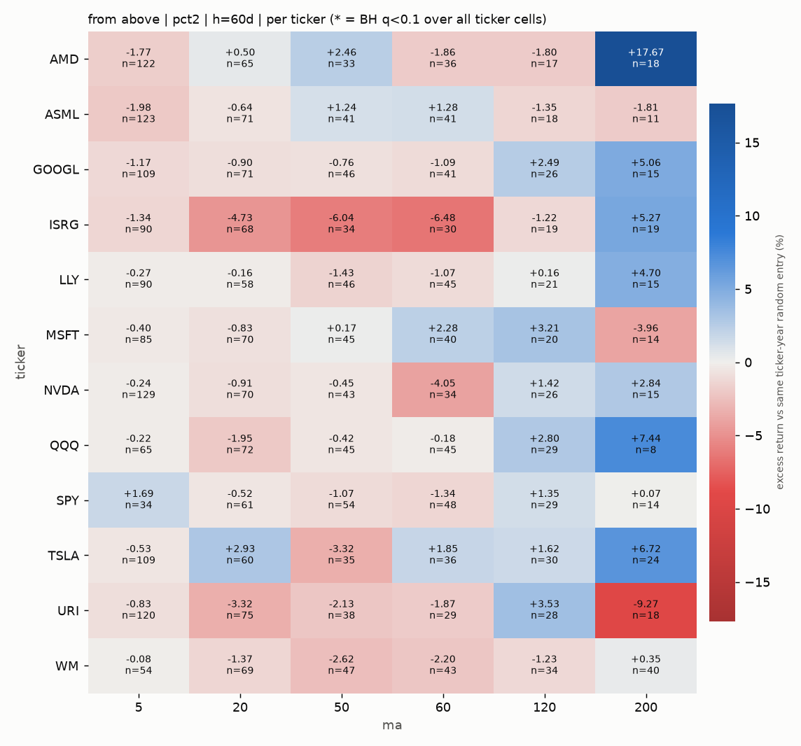

## 4. Regime dependence (SPY above vs below its 200-day SMA at signal date)

| MA | band | h | n up | excess up | n down | excess down |
|---|---|---|---|---|---|---|
| 5 | atr1 | 20 | 799 | -1.20% | 181 | 2.30% |
| 20 | atr1 | 20 | 728 | -1.25% | 151 | 1.35% |
| 50 | atr1 | 20 | 438 | -1.20% | 98 | -2.48% |
| 60 | atr1 | 20 | 413 | -0.77% | 92 | -1.33% |
| 120 | atr1 | 20 | 256 | -0.52% | 69 | 0.31% |
| 200 | atr1 | 20 | 177 | -0.20% | 52 | 1.31% |
| 5 | atr1 | 60 | 778 | -4.27% | 181 | 6.71% |
| 20 | atr1 | 60 | 703 | -2.61% | 151 | 3.47% |
| 50 | atr1 | 60 | 426 | -2.03% | 98 | 0.53% |
| 60 | atr1 | 60 | 403 | -1.81% | 92 | 3.60% |
| 120 | atr1 | 60 | 246 | 0.49% | 69 | 5.95% |
| 200 | atr1 | 60 | 173 | 2.45% | 52 | 7.18% |
| 5 | atr1 | 120 | 741 | -5.15% | 181 | 8.77% |
| 20 | atr1 | 120 | 670 | -3.92% | 151 | 6.02% |
| 50 | atr1 | 120 | 402 | -2.21% | 98 | 6.41% |
| 60 | atr1 | 120 | 382 | -2.40% | 92 | 10.58% |
| 120 | atr1 | 120 | 232 | 2.44% | 69 | 11.42% |
| 200 | atr1 | 120 | 166 | 6.14% | 52 | 10.68% |
| 5 | pct3 | 20 | 595 | -1.87% | 214 | 2.70% |
| 20 | pct3 | 20 | 638 | -1.16% | 162 | 1.39% |
| 50 | pct3 | 20 | 455 | -1.20% | 87 | -2.24% |
| 60 | pct3 | 20 | 419 | -0.90% | 86 | -1.47% |
| 120 | pct3 | 20 | 278 | -0.20% | 60 | -0.40% |
| 200 | pct3 | 20 | 175 | -0.56% | 55 | 5.26% |
| 5 | pct3 | 60 | 575 | -4.51% | 214 | 6.41% |
| 20 | pct3 | 60 | 612 | -2.52% | 162 | 4.03% |
| 50 | pct3 | 60 | 446 | -1.65% | 87 | -0.09% |
| 60 | pct3 | 60 | 409 | -0.96% | 86 | 0.59% |
| 120 | pct3 | 60 | 267 | -0.28% | 60 | 3.23% |
| 200 | pct3 | 60 | 171 | 2.47% | 55 | 7.31% |
| 5 | pct3 | 120 | 536 | -6.50% | 214 | 7.40% |
| 20 | pct3 | 120 | 579 | -3.30% | 162 | 5.71% |
| 50 | pct3 | 120 | 423 | -2.47% | 87 | 5.45% |
| 60 | pct3 | 120 | 388 | -2.37% | 86 | 6.06% |
| 120 | pct3 | 120 | 252 | 1.42% | 60 | 7.00% |
| 200 | pct3 | 120 | 164 | 5.23% | 55 | 9.53% |
| 5 | pct5 | 20 | 264 | -2.39% | 109 | 5.47% |
| 20 | pct5 | 20 | 472 | -1.57% | 127 | 2.80% |
| 50 | pct5 | 20 | 443 | -1.06% | 80 | -1.36% |
| 60 | pct5 | 20 | 444 | -0.54% | 72 | -1.26% |
| 120 | pct5 | 20 | 322 | -0.79% | 60 | 1.43% |
| 200 | pct5 | 20 | 195 | -0.63% | 53 | 5.90% |
| 5 | pct5 | 60 | 259 | -7.17% | 109 | 13.04% |
| 20 | pct5 | 60 | 461 | -2.60% | 127 | 4.44% |
| 50 | pct5 | 60 | 431 | -2.38% | 80 | 1.94% |
| 60 | pct5 | 60 | 434 | -0.90% | 72 | 3.29% |
| 120 | pct5 | 60 | 310 | -0.81% | 60 | 5.80% |
| 200 | pct5 | 60 | 193 | 2.23% | 53 | 7.97% |
| 5 | pct5 | 120 | 241 | -10.72% | 109 | 14.87% |
| 20 | pct5 | 120 | 430 | -5.43% | 127 | 7.84% |
| 50 | pct5 | 120 | 407 | -3.25% | 80 | 7.11% |
| 60 | pct5 | 120 | 408 | -1.87% | 72 | 9.98% |
| 120 | pct5 | 120 | 294 | 1.10% | 60 | 14.90% |
| 200 | pct5 | 120 | 182 | 4.37% | 53 | 9.98% |

## 5. Year-by-year stability (from above, band pct5, excess %)

| h | MA | 2020 | 2021 | 2022 | 2023 | 2024 | 2025 | 2026 |
|---|---|---|---|---|---|---|---|---|
| 20 | 5 | 1.63% | -3.65% | -0.53% | 1.54% | 1.38% | -1.63% | -1.19% |
| 20 | 20 | 0.53% | -2.20% | -4.17% | -0.18% | 0.30% | 1.14% | -0.60% |
| 20 | 50 | -0.50% | -0.58% | -5.40% | -0.93% | 1.44% | -0.97% | -2.56% |
| 20 | 60 | 0.49% | 0.46% | -4.79% | -1.45% | 1.61% | -1.30% | -2.28% |
| 20 | 120 | 2.26% | 1.89% | -3.79% | -2.23% | 1.01% | -3.55% | -1.52% |
| 20 | 200 | 2.52% | 4.75% | -2.01% | -0.47% | 1.24% | 0.37% | 0.27% |
| 60 | 5 | 1.70% | -7.47% | -0.43% | -0.44% | -1.60% | 1.52% | -6.42% |
| 60 | 20 | 1.58% | -1.55% | -5.36% | -2.03% | 1.92% | 0.88% | -6.06% |
| 60 | 50 | -0.09% | -0.20% | -5.96% | -3.13% | 2.40% | -4.68% | -4.59% |
| 60 | 60 | 2.38% | 0.40% | -2.29% | -4.06% | 3.95% | -3.72% | -3.30% |
| 60 | 120 | 4.83% | 0.18% | -3.11% | 1.97% | 2.15% | -5.65% | -2.62% |
| 60 | 200 | 6.26% | 8.37% | -5.05% | 5.70% | 2.39% | -1.93% | 10.87% |

## 6. Tradable strategy (buy next open after dip, hold h days, 5 bps/side)

Equal-weight portfolio across all tickers (idle sleeve = cash at 0%) vs equal-weight buy & hold.

| MA | band | h | CAGR | B&H CAGR | Sharpe | B&H Sharpe | MaxDD | B&H MaxDD |
|---|---|---|---|---|---|---|---|---|
| 5 | atr1 | 5 | 4.8% | 35.4% | 0.59 | 1.26 | -16% | -36% |
| 5 | atr1 | 10 | 14.4% | 35.4% | 1.03 | 1.26 | -20% | -36% |
| 5 | atr1 | 20 | 21.7% | 35.4% | 1.09 | 1.26 | -37% | -36% |
| 5 | atr1 | 60 | 34.6% | 35.4% | 1.25 | 1.26 | -36% | -36% |
| 5 | atr1 | 120 | 35.2% | 35.4% | 1.26 | 1.26 | -36% | -36% |
| 5 | atr1 | 250 | 35.2% | 35.4% | 1.26 | 1.26 | -36% | -36% |
| 20 | atr1 | 5 | 6.5% | 35.4% | 0.89 | 1.26 | -16% | -36% |
| 20 | atr1 | 10 | 10.6% | 35.4% | 0.90 | 1.26 | -24% | -36% |
| 20 | atr1 | 20 | 14.8% | 35.4% | 0.82 | 1.26 | -36% | -36% |
| 20 | atr1 | 60 | 31.9% | 35.4% | 1.18 | 1.26 | -35% | -36% |
| 20 | atr1 | 120 | 34.3% | 35.4% | 1.23 | 1.26 | -36% | -36% |
| 20 | atr1 | 250 | 34.2% | 35.4% | 1.23 | 1.26 | -36% | -36% |
| 50 | atr1 | 5 | 2.3% | 35.4% | 0.44 | 1.26 | -12% | -36% |
| 50 | atr1 | 10 | 4.5% | 35.4% | 0.54 | 1.26 | -20% | -36% |
| 50 | atr1 | 20 | 5.1% | 35.4% | 0.42 | 1.26 | -34% | -36% |
| 50 | atr1 | 60 | 21.7% | 35.4% | 0.94 | 1.26 | -38% | -36% |
| 50 | atr1 | 120 | 32.5% | 35.4% | 1.20 | 1.26 | -36% | -36% |
| 50 | atr1 | 250 | 34.2% | 35.4% | 1.24 | 1.26 | -36% | -36% |
| 60 | atr1 | 5 | 4.3% | 35.4% | 0.79 | 1.26 | -8% | -36% |
| 60 | atr1 | 10 | 4.2% | 35.4% | 0.52 | 1.26 | -20% | -36% |
| 60 | atr1 | 20 | 8.2% | 35.4% | 0.63 | 1.26 | -32% | -36% |
| 60 | atr1 | 60 | 22.2% | 35.4% | 0.99 | 1.26 | -38% | -36% |
| 60 | atr1 | 120 | 32.4% | 35.4% | 1.22 | 1.26 | -36% | -36% |
| 60 | atr1 | 250 | 34.8% | 35.4% | 1.27 | 1.26 | -36% | -36% |
| 120 | atr1 | 5 | 2.6% | 35.4% | 0.57 | 1.26 | -7% | -36% |
| 120 | atr1 | 10 | 3.2% | 35.4% | 0.44 | 1.26 | -15% | -36% |
| 120 | atr1 | 20 | 5.6% | 35.4% | 0.50 | 1.26 | -22% | -36% |
| 120 | atr1 | 60 | 19.6% | 35.4% | 1.06 | 1.26 | -25% | -36% |
| 120 | atr1 | 120 | 31.2% | 35.4% | 1.29 | 1.26 | -31% | -36% |
| 120 | atr1 | 250 | 36.8% | 35.4% | 1.34 | 1.26 | -35% | -36% |
| 200 | atr1 | 5 | 0.2% | 35.4% | 0.08 | 1.26 | -9% | -36% |
| 200 | atr1 | 10 | 1.6% | 35.4% | 0.25 | 1.26 | -13% | -36% |
| 200 | atr1 | 20 | 4.6% | 35.4% | 0.45 | 1.26 | -19% | -36% |
| 200 | atr1 | 60 | 16.3% | 35.4% | 1.01 | 1.26 | -20% | -36% |
| 200 | atr1 | 120 | 25.7% | 35.4% | 1.26 | 1.26 | -28% | -36% |
| 200 | atr1 | 250 | 35.9% | 35.4% | 1.38 | 1.26 | -33% | -36% |
| 5 | pct2 | 5 | 8.2% | 35.4% | 0.82 | 1.26 | -13% | -36% |
| 5 | pct2 | 10 | 20.3% | 35.4% | 1.17 | 1.26 | -22% | -36% |
| 5 | pct2 | 20 | 26.8% | 35.4% | 1.18 | 1.26 | -33% | -36% |
| 5 | pct2 | 60 | 34.2% | 35.4% | 1.26 | 1.26 | -36% | -36% |
| 5 | pct2 | 120 | 34.6% | 35.4% | 1.25 | 1.26 | -36% | -36% |
| 5 | pct2 | 250 | 35.0% | 35.4% | 1.26 | 1.26 | -36% | -36% |
| 20 | pct2 | 5 | 4.8% | 35.4% | 0.72 | 1.26 | -12% | -36% |
| 20 | pct2 | 10 | 7.5% | 35.4% | 0.69 | 1.26 | -23% | -36% |
| 20 | pct2 | 20 | 13.5% | 35.4% | 0.78 | 1.26 | -34% | -36% |
| 20 | pct2 | 60 | 31.7% | 35.4% | 1.19 | 1.26 | -35% | -36% |
| 20 | pct2 | 120 | 34.2% | 35.4% | 1.23 | 1.26 | -36% | -36% |
| 20 | pct2 | 250 | 34.2% | 35.4% | 1.23 | 1.26 | -36% | -36% |
| 50 | pct2 | 5 | 2.6% | 35.4% | 0.52 | 1.26 | -9% | -36% |
| 50 | pct2 | 10 | 3.9% | 35.4% | 0.50 | 1.26 | -16% | -36% |
| 50 | pct2 | 20 | 6.1% | 35.4% | 0.51 | 1.26 | -30% | -36% |
| 50 | pct2 | 60 | 22.6% | 35.4% | 1.02 | 1.26 | -35% | -36% |
| 50 | pct2 | 120 | 30.7% | 35.4% | 1.18 | 1.26 | -37% | -36% |
| 50 | pct2 | 250 | 32.5% | 35.4% | 1.21 | 1.26 | -36% | -36% |
| 60 | pct2 | 5 | 1.4% | 35.4% | 0.30 | 1.26 | -9% | -36% |
| 60 | pct2 | 10 | 3.6% | 35.4% | 0.48 | 1.26 | -16% | -36% |
| 60 | pct2 | 20 | 6.0% | 35.4% | 0.52 | 1.26 | -29% | -36% |
| 60 | pct2 | 60 | 21.2% | 35.4% | 1.00 | 1.26 | -35% | -36% |
| 60 | pct2 | 120 | 32.4% | 35.4% | 1.25 | 1.26 | -37% | -36% |
| 60 | pct2 | 250 | 34.6% | 35.4% | 1.28 | 1.26 | -36% | -36% |
| 120 | pct2 | 5 | 2.8% | 35.4% | 0.70 | 1.26 | -7% | -36% |
| 120 | pct2 | 10 | 2.4% | 35.4% | 0.38 | 1.26 | -14% | -36% |
| 120 | pct2 | 20 | 3.6% | 35.4% | 0.39 | 1.26 | -24% | -36% |
| 120 | pct2 | 60 | 18.3% | 35.4% | 1.08 | 1.26 | -26% | -36% |
| 120 | pct2 | 120 | 29.8% | 35.4% | 1.30 | 1.26 | -32% | -36% |
| 120 | pct2 | 250 | 35.3% | 35.4% | 1.34 | 1.26 | -35% | -36% |
| 200 | pct2 | 5 | 1.1% | 35.4% | 0.37 | 1.26 | -7% | -36% |
| 200 | pct2 | 10 | 1.2% | 35.4% | 0.24 | 1.26 | -10% | -36% |
| 200 | pct2 | 20 | 4.7% | 35.4% | 0.59 | 1.26 | -13% | -36% |
| 200 | pct2 | 60 | 13.5% | 35.4% | 1.01 | 1.26 | -21% | -36% |
| 200 | pct2 | 120 | 21.4% | 35.4% | 1.22 | 1.26 | -28% | -36% |
| 200 | pct2 | 250 | 29.4% | 35.4% | 1.29 | 1.26 | -32% | -36% |
| 5 | pct5 | 5 | 2.9% | 35.4% | 0.50 | 1.26 | -10% | -36% |
| 5 | pct5 | 10 | 11.2% | 35.4% | 1.14 | 1.26 | -11% | -36% |
| 5 | pct5 | 20 | 13.4% | 35.4% | 1.03 | 1.26 | -25% | -36% |
| 5 | pct5 | 60 | 24.3% | 35.4% | 1.24 | 1.26 | -31% | -36% |
| 5 | pct5 | 120 | 30.6% | 35.4% | 1.36 | 1.26 | -32% | -36% |
| 5 | pct5 | 250 | 35.8% | 35.4% | 1.47 | 1.26 | -30% | -36% |
| 20 | pct5 | 5 | 3.6% | 35.4% | 0.60 | 1.26 | -12% | -36% |
| 20 | pct5 | 10 | 9.6% | 35.4% | 0.98 | 1.26 | -21% | -36% |
| 20 | pct5 | 20 | 14.8% | 35.4% | 0.98 | 1.26 | -35% | -36% |
| 20 | pct5 | 60 | 28.9% | 35.4% | 1.21 | 1.26 | -38% | -36% |
| 20 | pct5 | 120 | 33.7% | 35.4% | 1.30 | 1.26 | -36% | -36% |
| 20 | pct5 | 250 | 34.5% | 35.4% | 1.31 | 1.26 | -36% | -36% |
| 50 | pct5 | 5 | 4.3% | 35.4% | 0.86 | 1.26 | -11% | -36% |
| 50 | pct5 | 10 | 5.0% | 35.4% | 0.65 | 1.26 | -21% | -36% |
| 50 | pct5 | 20 | 7.3% | 35.4% | 0.60 | 1.26 | -32% | -36% |
| 50 | pct5 | 60 | 22.2% | 35.4% | 1.02 | 1.26 | -39% | -36% |
| 50 | pct5 | 120 | 31.3% | 35.4% | 1.22 | 1.26 | -35% | -36% |
| 50 | pct5 | 250 | 33.0% | 35.4% | 1.25 | 1.26 | -36% | -36% |
| 60 | pct5 | 5 | 4.1% | 35.4% | 0.78 | 1.26 | -10% | -36% |
| 60 | pct5 | 10 | 5.4% | 35.4% | 0.69 | 1.26 | -19% | -36% |
| 60 | pct5 | 20 | 8.5% | 35.4% | 0.68 | 1.26 | -27% | -36% |
| 60 | pct5 | 60 | 22.3% | 35.4% | 1.02 | 1.26 | -37% | -36% |
| 60 | pct5 | 120 | 32.4% | 35.4% | 1.22 | 1.26 | -36% | -36% |
| 60 | pct5 | 250 | 34.3% | 35.4% | 1.24 | 1.26 | -36% | -36% |
| 120 | pct5 | 5 | 2.0% | 35.4% | 0.42 | 1.26 | -8% | -36% |
| 120 | pct5 | 10 | 4.7% | 35.4% | 0.60 | 1.26 | -14% | -36% |
| 120 | pct5 | 20 | 6.0% | 35.4% | 0.53 | 1.26 | -22% | -36% |
| 120 | pct5 | 60 | 19.7% | 35.4% | 1.06 | 1.26 | -25% | -36% |
| 120 | pct5 | 120 | 32.2% | 35.4% | 1.32 | 1.26 | -31% | -36% |
| 120 | pct5 | 250 | 36.3% | 35.4% | 1.32 | 1.26 | -36% | -36% |
| 200 | pct5 | 5 | 1.1% | 35.4% | 0.29 | 1.26 | -6% | -36% |
| 200 | pct5 | 10 | 2.8% | 35.4% | 0.45 | 1.26 | -13% | -36% |
| 200 | pct5 | 20 | 6.8% | 35.4% | 0.67 | 1.26 | -18% | -36% |
| 200 | pct5 | 60 | 18.4% | 35.4% | 1.12 | 1.26 | -18% | -36% |
| 200 | pct5 | 120 | 25.8% | 35.4% | 1.24 | 1.26 | -28% | -36% |
| 200 | pct5 | 250 | 35.5% | 35.4% | 1.36 | 1.26 | -35% | -36% |

Per ticker x spec (all MAs and bands): share where the dip strategy's Sharpe beats ...

| h | ticker-specs | ... buy & hold | ... median random entry (same #trades, same h) | in top 10% of random | median exposure |
|---|---|---|---|---|---|
| 5 | 432 | 5% | 49% | 12% | 12% |
| 10 | 432 | 6% | 43% | 6% | 22% |
| 20 | 432 | 4% | 35% | 3% | 38% |
| 60 | 432 | 18% | 41% | 5% | 74% |
| 120 | 432 | 33% | 45% | 5% | 93% |
| 250 | 432 | 54% | 55% | 9% | 98% |

Under the null of no timing skill, 'beats median random' should be ~50% and 'top 10%' ~10%.
